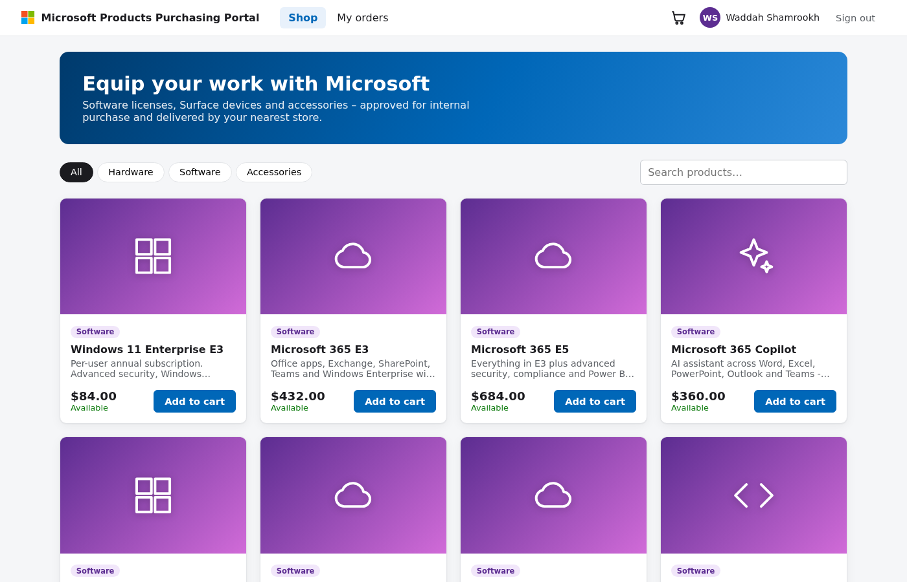
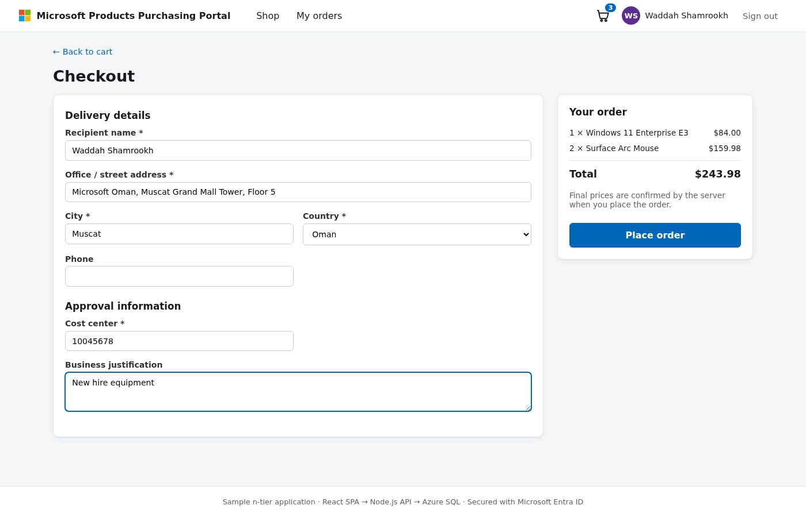
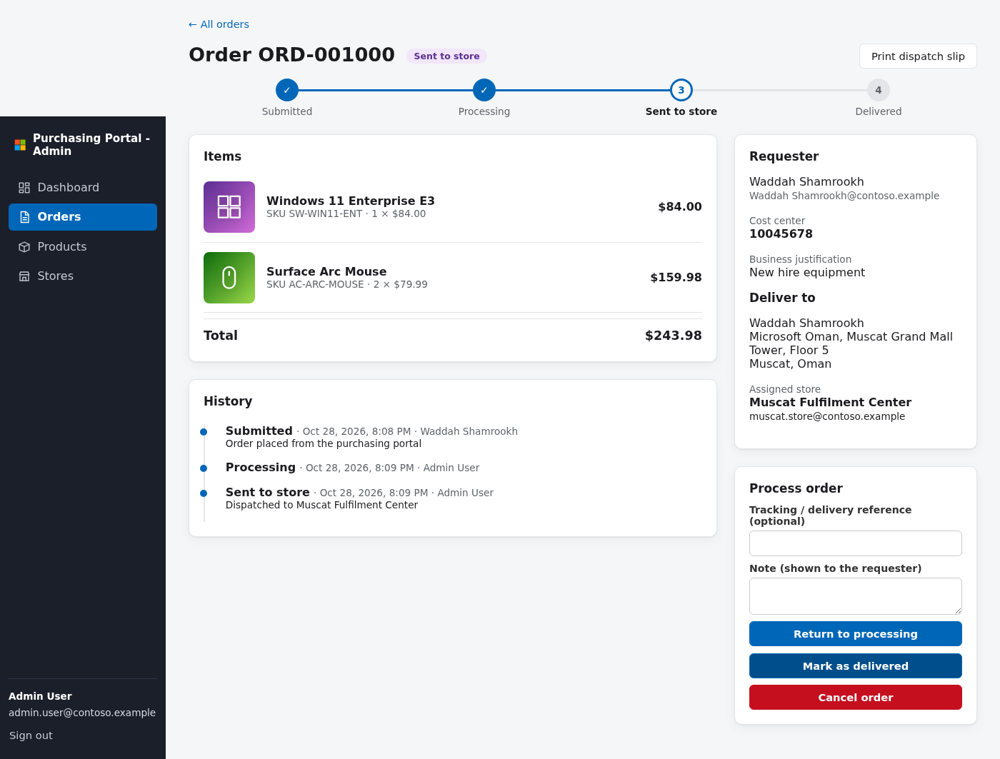
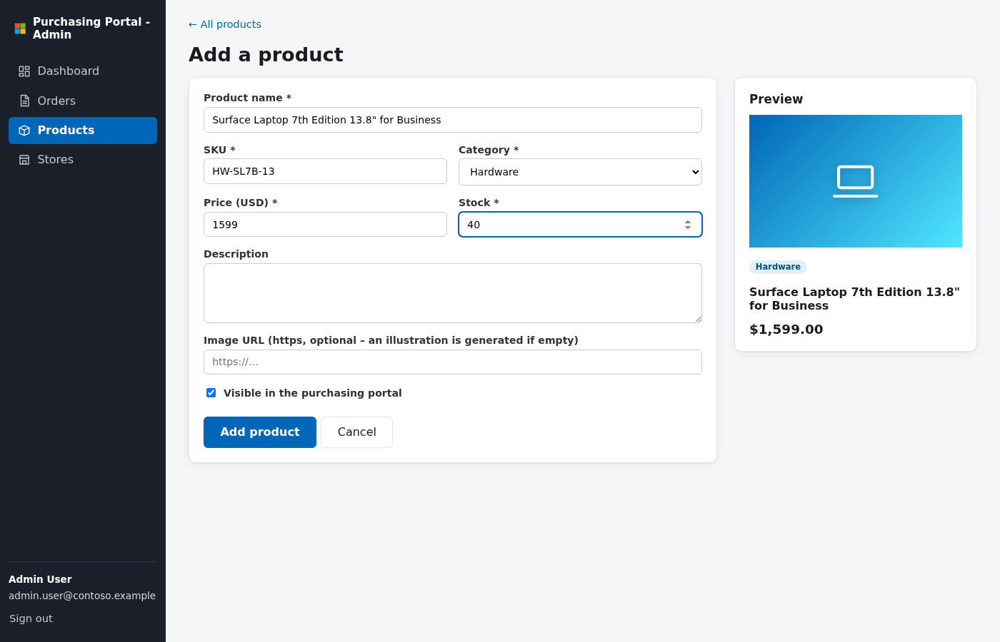

# Microsoft Products Purchasing Portal – n-tier sample on Azure

A complete **3-tier sample application** for internal employees to order Microsoft software, devices and accessories,
plus an **admin portal** where the fulfilment team processes orders and dispatches them to stores for delivery.
Both front-ends sign users in with **Microsoft Entra ID**.

```
┌──────────────────────────┐      ┌──────────────────────────┐
│ Purchasing portal (SPA)  │      │ Admin portal (SPA)       │      Presentation tier
│ React + MSAL.js          │      │ React + MSAL.js          │      (2 × App Service)
└────────────┬─────────────┘      └────────────┬─────────────┘
             │  HTTPS + Entra ID access token (scope access_as_user)
             ▼                                 ▼
        ┌────────────────────────────────────────────┐
        │ Backend API – Node.js / Express            │                Business tier
        │ validates tokens, Store.Admin app role     │                (App Service)
        └────────────────────┬───────────────────────┘
                             │  VNet integration → private endpoint
                             │  TDS/TLS – managed identity (no passwords)
                             ▼
        ┌────────────────────────────────────────────┐
        │ Azure SQL Database (Entra-only auth,       │                Data tier
        │ public network access disabled)            │
        └────────────────────────────────────────────┘
```

## Features

**Purchasing portal** (`/portal`)
- Sign in with your organization (Entra ID) account
- Catalog of 29 sample products – **Software** (Windows 11 Enterprise, Microsoft 365 E3/E5, Copilot, Office LTSC, Visio, Project, Visual Studio, SQL Server…), **Hardware** (Surface Laptop 7, Surface Pro 11, Surface Laptop Studio 2, Surface Go 4, Surface Hub 3, Xbox) and **Accessories** (Arc Mouse, keyboards, Slim Pen 2, Thunderbolt 4 Dock, headphones, webcam…)
- Category filter and search, product pages, stock levels
- Shopping cart (kept in the browser) and **checkout** with delivery address, cost center and business justification
- "My orders" with a live status tracker and history; cancel while still *Submitted*

**Admin portal** (`/admin`) – requires the **`Store.Admin`** app role
- Dashboard: order KPIs, queue of new orders, top products, low-stock alerts
- Order processing workflow: **Submitted → Processing → Sent to store → Delivered** (or Cancelled – stock is returned)
- Dispatch to a store (the store matching the delivery city/country is suggested), tracking reference, notes, printable dispatch slip
- **Add and edit products** (price, stock, category, description, optional image URL, show/hide)
- Manage the stores that deliver orders

**API** (`/api`) – Node.js 20+/Express, `mssql`
- Entra ID JWT validation with Node's built-in crypto (signature, issuer, audience, expiry, tenant, scope)
- Admin endpoints protected by the `Store.Admin` app role
- Server-side pricing and stock checks inside SQL transactions, full order history/audit trail
- Connects to Azure SQL with the App Service **managed identity**

## Screenshots

| Catalog | Checkout |
|---|---|
|  |  |
| **Admin – process & dispatch an order** | **Admin – add a product** |
|  |  |

## Repository layout

```
api/            Node.js REST API
  db/schema.sql   tables (Products, Orders, OrderItems, OrderHistory, Stores)
  db/seed.sql     sample stores and products
  scripts/db-init.js  creates schema/seed data and grants the managed identity access
portal/         purchasing portal SPA (React + Vite + MSAL)
admin/          admin portal SPA (React + Vite + MSAL)
deploy/
  azure-deploy.sh   az cli script – creates everything in Azure and deploys from GitHub
  cleanup.sh        deletes everything again
scripts/publish-to-github.sh
docker-compose.yml  local SQL Server for development
```

## Deploy to Azure (az cli)

Run in **Azure Cloud Shell (Bash)** – it already has `az`, `git`, `node`, `npm`, `zip` and `curl`:

```bash
curl -sO https://raw.githubusercontent.com/wshamroukh/msproducts-purchasing-portal/main/deploy/azure-deploy.sh
chmod +x azure-deploy.sh
./azure-deploy.sh
```

Optional settings (environment variables):

| Variable | Default | Purpose |
|---|---|---|
| `LOCATION` | `uaenorth` | Azure region |
| `PREFIX` | `msstore` | Name prefix for all resources |
| `RG` | `rg-<prefix>-<random>` | Resource group name |
| `APP_SKU` | `B1` | App Service plan SKU |
| `SQL_SKU` | `Basic` | Azure SQL service objective |
| `ADMIN_UPNS` | – | Extra users (comma separated) who get the `Store.Admin` role |
| `REPO_URL` / `BRANCH` | this repo / `main` | Source to clone |

Example: `LOCATION=westeurope ADMIN_UPNS="alice@contoso.com" ./azure-deploy.sh`

What the script does:
1. Clones this repository
2. Creates a resource group, a Linux App Service plan and 3 web apps (Node 22 LTS)
3. Creates 3 **Entra ID app registrations**: the API (exposes scope `access_as_user` and app role `Store.Admin`, access token v2) and the two SPAs (redirect URIs, API permission, pre-authorized so no consent prompt for the API)
4. Assigns **you** the `Store.Admin` role
5. Creates a **virtual network**, an **Azure SQL** server with Entra-only authentication and **public network access disabled**,
   a **private endpoint** + private DNS zone, and connects the API web app to the VNet
6. Makes the API's **managed identity** the SQL Entra admin – on first start the API creates the tables and **sample data** itself
7. Builds the API and both SPAs, sets App Settings, zip-deploys the three apps and waits for `/api/health`

This works in subscriptions with policies that deny public access to SQL (no firewall rules are needed).
The state file is written while the script runs, so `cleanup.sh` also works after a failed run.

At the end it prints the portal, admin and API URLs and writes `deployment-<prefix>-<suffix>.env`.
Remove everything with `./cleanup.sh deployment-<prefix>-<suffix>.env`.

> **Permissions needed:** Contributor on the subscription and the right to create app registrations in your tenant
> (default for members, or *Application Developer*). If your tenant requires admin consent for apps, ask an admin to grant
> consent for the two SPA registrations (the script tries automatically).

## Run locally

Prerequisites: Node.js 20+, Docker (for SQL Server).

```bash
docker compose up -d                       # SQL Server 2022 on localhost:1433

cd api && cp .env.example .env && npm install && npm run dev     # http://localhost:3000 – creates DB + sample data
cd portal && npm install && npm run dev                          # http://localhost:5173
cd admin  && npm install && npm run dev                          # http://localhost:5174
```

`.env.example` and the SPAs' `public/config.json` use **`AUTH_MODE=dev`**: no Entra ID needed, you just type a name at
sign-in (the admin portal acts as `Store.Admin`). **Never use dev mode in Azure.**

To use Entra ID locally, set `AUTH_MODE=entra`, `TENANT_ID` and `API_CLIENT_ID` in `api/.env`, and in each
`public/config.json` set `"authMode": "entra"`, `tenantId`, `clientId` (the SPA registration) and
`apiScope` (`api://<api-client-id>/access_as_user`). The deployment script already registers
`http://localhost:5173/` and `http://localhost:5174/` as redirect URIs.

## Configuration reference

**API** (App Settings / `.env`)

| Setting | Description |
|---|---|
| `AUTH_MODE` | `entra` (default) or `dev` |
| `TENANT_ID`, `API_CLIENT_ID` | Tenant and API app registration used to validate tokens |
| `API_SCOPE_NAME` | Required delegated scope (default `access_as_user`) |
| `ADMIN_ROLE` | App role required for `/api/admin/*` (default `Store.Admin`) |
| `CORS_ORIGINS` | Comma-separated SPA origins |
| `SQL_SERVER`, `SQL_DATABASE` | Database location |
| `SQL_AUTH` | `managed-identity` (Azure), `password` (local), `access-token` |
| `DB_AUTO_INIT` | `true` creates schema + sample data at start-up |

**SPAs** – `server.cjs` serves the build and generates `/config.json` from these App Settings, so one build runs anywhere:
`AUTH_MODE`, `TENANT_ID`, `CLIENT_ID`, `API_SCOPE`, `API_BASE_URL`, `APP_TITLE`.

## API endpoints

| Method | Path | Who |
|---|---|---|
| GET | `/api/health` | anonymous |
| GET | `/api/me` | signed-in user |
| GET | `/api/products`, `/api/products/:id` | signed-in user |
| POST | `/api/orders` (checkout) | signed-in user |
| GET | `/api/orders`, `/api/orders/:id` | signed-in user (own orders) |
| POST | `/api/orders/:id/cancel` | signed-in user (own, *Submitted*) |
| GET | `/api/admin/stats` | Store.Admin |
| GET | `/api/admin/orders`, `/api/admin/orders/:id` | Store.Admin |
| PATCH | `/api/admin/orders/:id/status` | Store.Admin |
| GET/POST/PUT | `/api/admin/products[/:id]` | Store.Admin |
| GET/POST/PUT | `/api/admin/stores[/:id]` | Store.Admin |

## Notes

- The database is reachable only from inside the VNet. To query it yourself, use a VM/Bastion or VPN into the VNet and
  temporarily set yourself (or a group you belong to) as the server's Entra admin.
- Product prices are illustrative sample values, not official Microsoft pricing.
- Product images are generated illustrations; admins can set an `https://` image URL per product.
- For production consider: Private Endpoints/VNet integration for SQL, Azure Front Door/WAF, Application Insights,
  staging slots and a CI/CD pipeline (GitHub Actions).
